<!-- Generated by scripts/render_cards.py. Edit profile.json, not this file.
     The cards are animated SVGs, refreshed every day by .github/workflows/refresh-cards.yml.
     Keep this block free of blank lines and each row of cards on one line: the gaps are inside the SVGs. -->

 
 
 
 
 

<a href="https://dev-portfolio-ten-azure.vercel.app">portfolio</a> &nbsp;/&nbsp; <a href="https://zime.ai">zime.ai</a>

