<!-- Generated by scripts/render_cards.py. Edit profile.json, not this file.
     The cards are animated SVGs, refreshed every day by .github/workflows/refresh-cards.yml.
     File names carry a content hash so GitHub's image cache never shows an old card.
     Keep this block free of blank lines and each row of cards on one line: the gaps are inside the SVGs. -->

 
 
 
 
 
 
 

